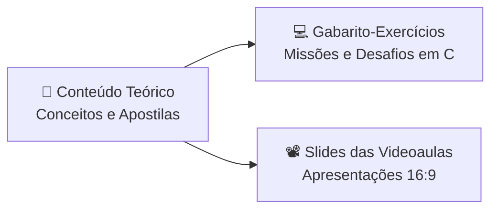
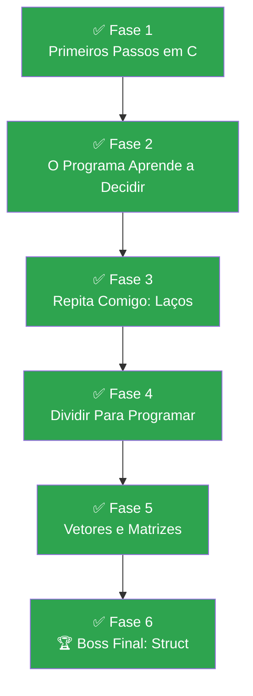

# 📖 Conteúdo Teórico

### A base conceitual e descritiva de cada fase, explicada antes da prática

*Toda boa jornada de programação começa com uma boa história.*

 

---

## 🧭 Sobre esta pasta

Aqui ficam os **materiais teóricos e pedagógicos** que sustentam a trilha de Fundamentos da Programação em C. Antes de partir para o compilador, é aqui que cada conceito é apresentado: com linguagem acessível, analogias do cotidiano, ilustrações didáticas e exemplos comentados passo a passo.

Os exercícios que consolidam esses conceitos na prática estão disponíveis em [`Gabarito-Exercícios`](../Gabarito-Exercícios), e as apresentações visuais utilizadas nas aulas estão em [`Slides`](../Slides).

---

## 📕 Ebook Oficial do Projeto (Volume Completo)

Disponibilizamos o ebook canônico da certificadora, diagramado com tipografia editorial de alta legibilidade, modelos visuais de memória e 100% livre de jargões inacessíveis:

- 📘 **[Ebook: Fundamentos de Programação em C — Try, Catch & Learn](./Ebook_Fundamentos_de_Programacao_C.pdf)**
  - **16 Páginas Temáticas A4** com capa cinematográfica, apresentação dos autores (Lauren, Lorena, Manuella, Renan), supervisão acadêmica (Prof. Dr. André Domingues), sumário geral e 13 capítulos exaustivos cobrindo desde a história mecânica de Jacquard/Ada Lovelace até matrizes e structs heterogêneas.
  - Diagramas técnicos de alta resolução integrados: Linha do Tempo, Pipeline GCC, Guia do OnlineGDB, Gavetas de Memória RAM, Fluxo de Decisão `if/else`, Anatomia do `for`, Layout de Vetor 1D, Grade de Matriz 2D e Ficha Cadastral da Struct.

---

## 📚 Materiais Didáticos por Fase

### 📘 Ebook Oficial do Curso
- 📄 [**`Ebook_Fundamentos_de_Programacao_C.pdf`**](./Ebook_Fundamentos_de_Programacao_C.pdf) (16 pgs) — *Fundamentos de Programação em C: Da Memória RAM às Estruturas Heterogêneas*. Guia visual completo desenvolvido para desmistificar a lógica de programação com analogias claras, diagramas e modelos conceituais.

---

### 📑 Apostilas e Cadernos por Módulo

<table>
<thead>
  <tr>
    <th width="80" align="center">Fase</th>
    <th>Módulo e Tópicos</th>
    <th>Documentos Disponíveis</th>
  </tr>
</thead>
<tbody>
  <tr>
    <td align="center"><strong>Fase 1</strong></td>
    <td>
      <strong>Primeiros Passos em C</strong> 
      Algoritmos, receitas lógicas, constantes, variáveis, tipos primitivos (<code>int</code>, <code>float</code>, <code>char</code>), operadores matemáticos e entrada/saída com <code>printf</code> e <code>scanf</code>.
    </td>
    <td>
      📄 <a href="./Fase%201%20-%20Primeiros%20Passos%20em%20C.pdf"><code>Fase 1 - Primeiros Passos em C.pdf</code></a>
    </td>
  </tr>
  <tr>
    <td align="center"><strong>Fase 2</strong></td>
    <td>
      <strong>O Programa Aprende a Decidir</strong> 
      Estruturas de seleção: decisões simples e compostas com <code>if/else</code>, encadeamento com <code>else if</code> e seleção múltipla com <code>switch-case</code> e <code>break</code>.
    </td>
    <td>
      📄 <a href="./Fase%202%20-%20O%20Programa%20Aprende%20a%20Decidir.pdf"><code>Fase 2 - O Programa Aprende a Decidir.pdf</code></a>
    </td>
  </tr>
  <tr>
    <td align="center"><strong>Fase 3</strong></td>
    <td>
      <strong>Repita Comigo: Laços de Repetição</strong> 
      Automatização de rotinas: repetição condicional com <code>while</code>, repetição com teste no final com <code>do-while</code>, repetição contada com <code>for</code>, acumuladores e desvios <code>break</code> e <code>continue</code>.
    </td>
    <td>
      📄 <a href="./Fase%203%20-%20Repita%20Comigo%20La%C3%A7os%20de%20Repeti%C3%A7%C3%A3o.pdf"><code>Fase 3 - Repita Comigo Laços de Repetição.pdf</code></a>
    </td>
  </tr>
  <tr>
    <td align="center"><strong>Fase 4</strong></td>
    <td>
      <strong>Dividir Para Programar: Modularização</strong> 
      Subprogramas e blocos reutilizáveis: procedimentos <code>void</code>, funções com valor de retorno tipado, parâmetros formais e argumentos reais, escopo de variáveis e protótipos.
    </td>
    <td>
      📄 <a href="./Aula%20Fase%204%20-%20Dividir%20Para%20Programar.pdf"><code>Aula Fase 4 - Dividir Para Programar.pdf</code></a>
    </td>
  </tr>
  <tr>
    <td align="center"><strong>Fases 5 e 6</strong></td>
    <td>
      <strong>Caderno de Missões e Gabarito Comentado III</strong> 
      Cobertura integrada das Fases 5 (Vetores 1D e Matrizes 2D) e 6 (Variáveis heterogêneas <code>struct</code>), contendo 20 missões detalhadas e 3 grandes desafios integradores.
    </td>
    <td>
      📄 <a href="./Caderno_de_Missoes_III.pdf"><code>Caderno_de_Missoes_III.pdf</code></a> (26 pgs) 
      📝 <a href="./Gabarito_Comentado_III.pdf"><code>Gabarito_Comentado_III.pdf</code></a> (30 pgs) 
      📚 <a href="./Caderno_e_Gabarito_III_Completo.pdf"><code>Caderno_e_Gabarito_III_Completo.pdf</code></a> (51 pgs)
    </td>
  </tr>
</tbody>
</table>

---

## 🎬 Videoaulas Gravadas

A pasta [`aulas/`](./aulas/) armazena arquivos de vídeo locais produzidos pela equipe do projeto:

- 🎥 **Aula 1 (`aulas/Aula1.mp4`):** Videoaula sobre Introdução a Algoritmos, Variáveis e Primeiros Passos em C, integrada ao player do portal web.

---

## 🗺️ Trilha Pedagógica Completa

---

## 📌 Recomendações de Estudo

1. **Leia a apostila teórica** antes de tentar programar: entender a lógica poupa horas de depuração.
2. **Acompanhe com os slides e videoaulas:** use os materiais visuais em [`Slides/`](../Slides) para fixar a sintaxe e ver analogias ilustradas.
3. **Pratique com o compilador:** acesse as soluções em [`Gabarito-Exercícios/`](../Gabarito-Exercícios) e compile os exemplos para testar entradas e saídas reais.

---

⬅️ [Voltar ao README principal](../README.md)

