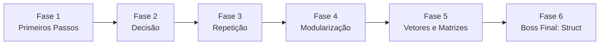
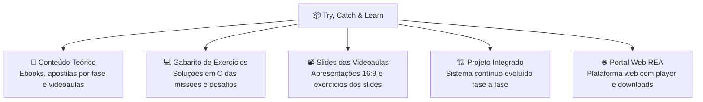

<div align="center">

# 🧩 Try, Catch & Learn

### Recursos Educacionais Abertos para Fundamentos da Programação em C

*Programar é tentar, tratar o erro e aprender com ele.*

<br>


<br>

**Universidade Tecnológica Federal do Paraná — Campus Cornélio Procópio**  
Disciplina: **Certificadora de Competência Comum**  
Supervisão: **Prof. Dr. André Luís dos Santos Domingues**

</div>

---

## 📑 Sumário

1. [Sobre o projeto](#-sobre-o-projeto)
2. [Objetivo geral](#-objetivo-geral)
3. [A Jornada em Seis Fases](#-a-jornada-em-seis-fases)
4. [Organização do Repositório (Os 5 Pilares)](#-organização-do-repositório-os-5-pilares)
5. [Estrutura de Pastas e Arquivos](#-estrutura-de-pastas-e-arquivos)
6. [Como Compilar e Executar](#-como-compilar-e-executar)
7. [Equipe](#-equipe)
8. [Licença e Reuso](#-licença-e-reuso)
9. [Como Citar](#-como-citar)

---

## 📖 Sobre o projeto

Este repositório reúne os **Recursos Educacionais Abertos (REA)** desenvolvidos pelo grupo **Try, Catch & Learn** no âmbito da disciplina **Certificadora de Competência Comum**, da Universidade Tecnológica Federal do Paraná (UTFPR), Campus Cornélio Procópio.

A proposta parte de uma constatação simples: o primeiro contato com programação costuma ser o maior filtro de acesso à área de tecnologia. Ao transformar conceitos fundamentais em materiais **abertos, lúdicos e didaticamente estruturados**, buscamos reduzir essa barreira de entrada e devolver à comunidade externa o conhecimento produzido na universidade, em consonância com o princípio da extensão universitária.

O nome do grupo faz referência ao bloco `try`/`catch` de tratamento de exceções: errar faz parte do processo, e o que importa é o que se aprende ao capturar o erro.

---

## 🎯 Objetivo geral

Desenvolver **Recursos Educacionais Abertos (REA)** voltados à disciplina de **Fundamentos da Programação**, com o objetivo de democratizar o acesso ao conhecimento inicial em programação por meio de materiais acessíveis, lúdicos e didaticamente estruturados, facilitando a compreensão de conceitos fundamentais por estudantes iniciantes e/ou público externo.

---

## 🗺️ A Jornada em Seis Fases

O aprendizado é estruturado como uma trilha contínua onde cada fase expande a anterior:

| Fase | Título | Foco Conceitual |
|:----:|--------|-----------------|
| **1** | **Primeiros Passos em C** | Constantes, variáveis, tipos primitivos (`int`, `float`, `char`), expressões aritméticas e entrada/saída (`printf`/`scanf`). |
| **2** | **O Programa Aprende a Decidir** | Tomada de decisões com `if`, `else`, encadeamento `else if` e seleção múltipla com `switch-case`. |
| **3** | **Repita Comigo: Laços de Repetição** | Automatização de rotinas com `while`, `do-while`, `for`, contadores, acumuladores e desvios (`break`/`continue`). |
| **4** | **Dividir para Programar: Modularização** | Procedimentos (`void`), funções com valor de retorno, parâmetros formais/argumentos, escopo e protótipos. |
| **5** | **Muitos Dados, Uma Só Caixa: Vetores e Matrizes** | Coleções homogêneas: vetores unidimensionais (1D), matrizes bidimensionais (2D), busca e laços aninhados. |
| **6** | **🏆 Boss Final: A Ficha Completa (Struct)** | Variáveis heterogêneas (`struct`), acesso com operador `.`, vetores de struct, passagem para funções e ponteiros (`->`). |



---

## 🏛️ Organização do Repositório (Os 5 Pilares)

Para manter cada conteúdo em seu devido lugar e facilitar o estudo de alunos e professores, o repositório está organizado em cinco pilares independentes e complementares:



1. **[📖 Conteúdo Teórico](./Conteúdo-Teórico/README.md):** Reúne o Ebook oficial do curso, as apostilas descritivas de cada fase em PDF, os cadernos oficiais de missões e gabaritos comentados, além de gravações de videoaulas em vídeo local (`aulas/Aula1.mp4`).
2. **[💻 Gabarito de Exercícios](./Gabarito-Exercícios/README.md):** Códigos-fonte em C com as soluções de referência de todas as questões dos Cadernos de Missões (Fases 1 a 6), incluindo os desafios integradores e códigos extras com propósitos didáticos de depuração.
3. **[📽️ Slides das Videoaulas](./Slides/README.md):** Apresentações visuais em alta resolução (formato widescreen 16:9) utilizadas nas aulas gravadas e a pasta de **[Exercícios Resolvidos dos Slides](./Slides/Exercicios-Resolvidos/README.md)** com os códigos C específicos passados durante os slides.
4. **[🏗️ Projeto Integrado](./Projeto-Integrado/README.md):** Aplicação prática contínua em C (`main.c`) demonstrando a construção incremental de um sistema real de cadastro que evoluiu pelas fases da disciplina.
5. **🌐 Portal Web REA:** Site interativo construído para o GitHub Pages (`index.html`, `js/`, `css/`, `assets/`), com player de videoaula integrado, player de playlist modular e central de downloads de PDFs.

---

## 🗂️ Estrutura de Pastas e Arquivos

```text
.
├── Conteúdo-Teórico/                              # Ebooks, apostilas conceituais e cadernos
│   ├── README.md                                  # Guia detalhado do conteúdo teórico
│   ├── Ebook_Fundamentos_de_Programacao_C.pdf     # Ebook visual oficial integrado (16 pgs)
│   ├── Fase 1 - Primeiros Passos em C.pdf         # Apostila descritiva Fase 1
│   ├── Fase 2 - O Programa Aprende a Decidir.pdf  # Apostila descritiva Fase 2
│   ├── Fase 3 - Repita Comigo Laços de...pdf      # Apostila descritiva Fase 3
│   ├── Aula Fase 4 - Dividir Para Programar.pdf   # Apostila descritiva Fase 4
│   ├── Caderno_de_Missoes_III.pdf                 # Caderno de Missões Fases 5 e 6 (26 pgs)
│   ├── Gabarito_Comentado_III.pdf                 # Gabarito Comentado Fases 5 e 6 (30 pgs)
│   ├── Caderno_e_Gabarito_III_Completo.pdf        # Edição Completa Integrada (51 pgs)
│   └── aulas/                                     # Videoaulas gravadas em MP4
│       └── Aula1.mp4                              # Videoaula 1: Introdução a Algoritmos e Variáveis
│
├── Gabarito-Exercícios/                           # Soluções em C dos Cadernos de Missões
│   ├── README.md                                  # Guia completo de exercícios e compilação
│   ├── Fase1-Primeiros-Passos/                    # Q1 a Q5: variáveis, tipos e expressões
│   ├── Fase2-Decisoes/                            # Q6 a Q10: if, else, switch e erros comuns
│   ├── Fase3-Lacos-de-Repeticao/                  # Q1 a Q10: while, do-while e for
│   ├── Fase4-Modularizacao/                       # Q1 a Q10: procedimentos e funções
│   ├── Fase5-Vetores-e-Matrizes/                  # Q1 a Q10: vetores 1D e matrizes 2D
│   ├── Fase6-Struct/                              # Q1 a Q10: estruturas e ponteiros
│   ├── Desafios/                                  # Desafios integradores (D1 a D3 por bloco)
│   └── Extras/                                    # Demonstração de erros e fall-through
│
├── Slides/                                        # Apresentações visuais das videoaulas
│   ├── README.md                                  # Guia de slides e apresentações
│   ├── Fase 5 - Muitos dados, uma só caixa...pdf  # Slides 16:9 de Vetores e Matrizes
│   ├── Fase 6 - Struct.pdf                        # Slides 16:9 de Structs
│   └── Exercicios-Resolvidos/                     # Códigos em C das missões dos slides
│       ├── README.md                              # Documentação dos exercícios dos slides
│       ├── Fase5-Vetores-e-Matrizes/              # Missões 1 a 4 dos slides de vetores/matrizes
│       └── Fase6-Struct/                          # Missões 1 a 4 dos slides de structs
│
├── Projeto-Integrado/                             # Sistema integrador contínuo
│   ├── README.md                                  # Documentação da aplicação
│   └── main.c                                     # Código do sistema de cadastro modular
│
├── assets/                                        # Imagens, favicon e fotos da equipe
├── css/                                           # Estilos visuais do portal web
├── js/                                            # Lógica do catálogo e player de videoaulas
├── index.html                                     # Portal web REA (GitHub Pages)
├── LICENSE                                        # Licença MIT de uso livre
└── README.md                                      # Este documento
```

---

## 🚀 Como Compilar e Executar

Todos os códigos em C do projeto seguem o padrão ANSI C / C99 / C11 e podem ser compilados diretamente pelo GCC, Clang ou compiladores online como o [Online GDB](https://www.onlinegdb.com/):

```bash
# 1. Clonar o repositório
git clone https://github.com/RenanCaceres/Certificadora-Comum.git
cd Certificadora-Comum

# 2. Compilar uma missão do Caderno de Missões
gcc -Wall -Wextra Gabarito-Exercícios/Fase1-Primeiros-Passos/q01_ficha_do_heroi.c -o missao
./missao

# 3. Compilar um exercício dos Slides de videoaulas
gcc -Wall -Wextra Slides/Exercicios-Resolvidos/Fase5-Vetores-e-Matrizes/m01_tesouro_cinco_baus.c -o slide_ex
./slide_ex

# 4. Compilar o Projeto Integrado
gcc -Wall -Wextra Projeto-Integrado/main.c -o projeto_integrado
./projeto_integrado
```

---

## 🤝 Equipe

**Grupo Try, Catch & Learn**

| Integrante | Papel Principal |
|------------|-----------------|
| **Lauren Marçulo** | Desenvolvimento & Conteúdo Didático (Fase 5) |
| **Lorena Eduarda Barros Martinelli** | Design Pedagógico & Apresentação (Fase 6) |
| **Manuella Vieira Reginato** | Curadoria de Exercícios & Documentação |
| **Renan Cáceres Anselmo** | Arquitetura, Desenvolvimento & Código em C |

**Supervisão:** Prof. Dr. André Luís dos Santos Domingues  
**Instituição:** Universidade Tecnológica Federal do Paraná (UTFPR), Campus Cornélio Procópio

---

## 📜 Licença e Reuso

Por se tratar de **Recursos Educacionais Abertos (REA)**, todo o conteúdo deste repositório (materiais didáticos, cadernos, apostilas, slides, resoluções e códigos em C) é distribuído sob a licença [**MIT**](LICENSE). Você é livre para estudar, copiar, modificar, distribuir e adaptar os materiais para salas de aula, oficinas e projetos pessoais.

---

## 🔖 Como Citar

```text
TRY, CATCH & LEARN. Recursos Educacionais Abertos para Fundamentos da Programação em C.
Cornélio Procópio: Universidade Tecnológica Federal do Paraná, 2026.
Disciplina: Certificadora de Competência Comum. Supervisão: Prof. Dr. André Luís dos Santos Domingues.
```

---

<div align="center">

**UTFPR — Campus Cornélio Procópio** · Certificadora de Competência Comum · 2026

*Feito com 💛 e muitos `printf("Olá, mundo!");`*

</div>
